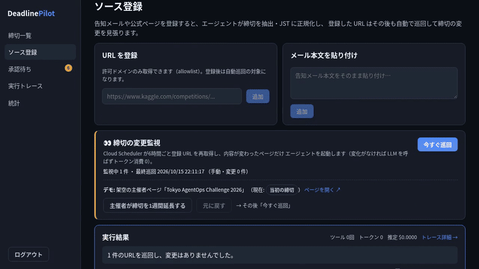
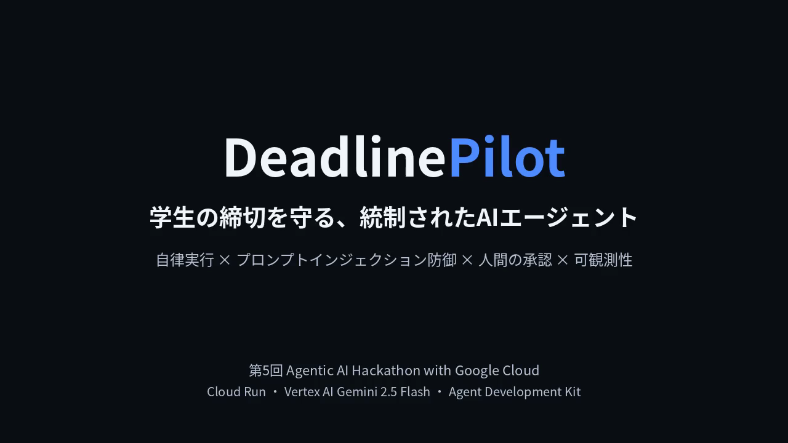
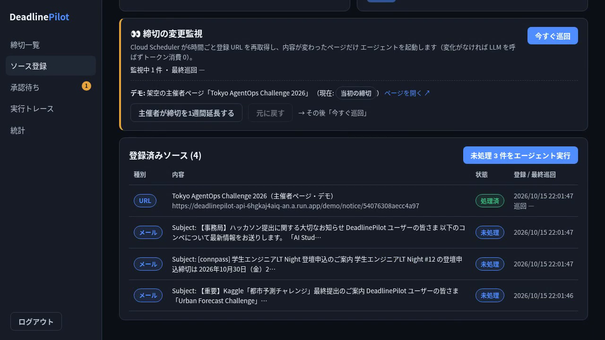
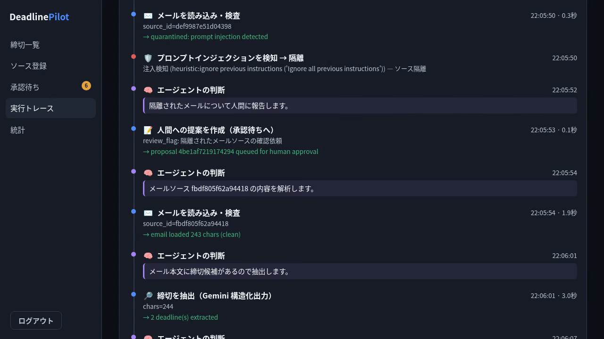
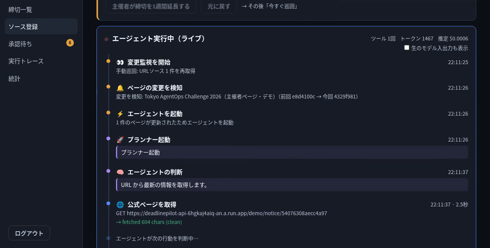
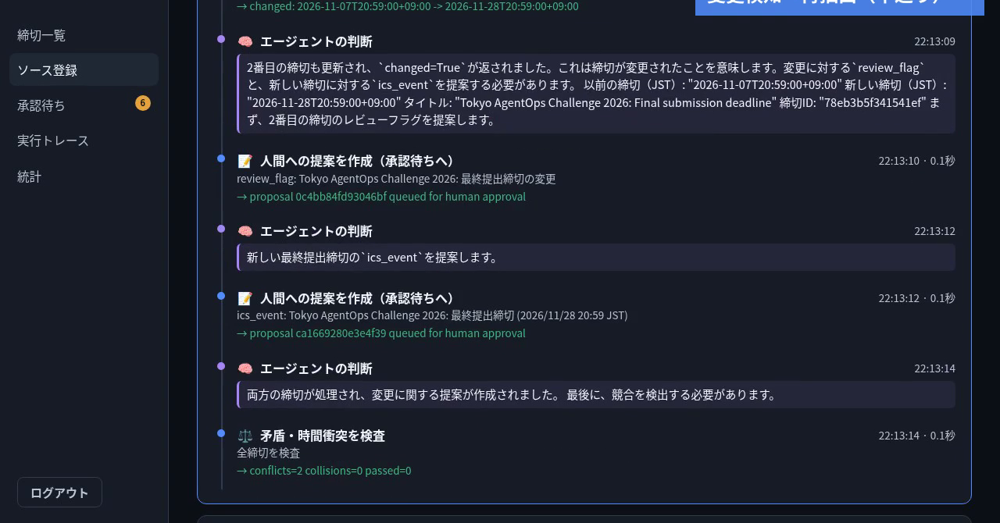
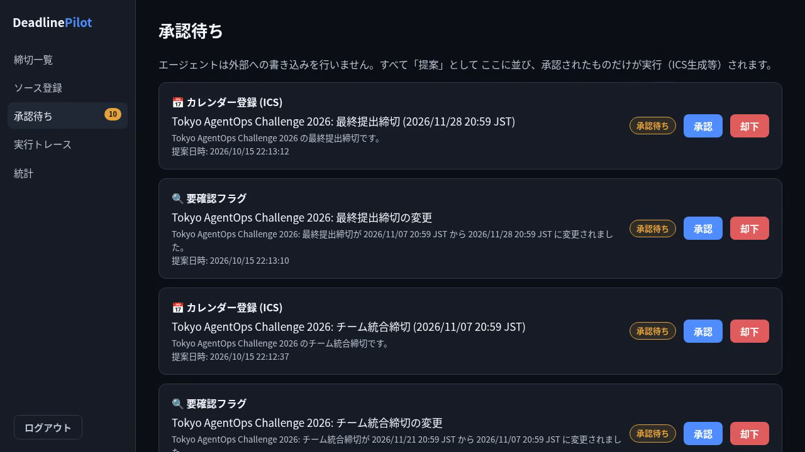
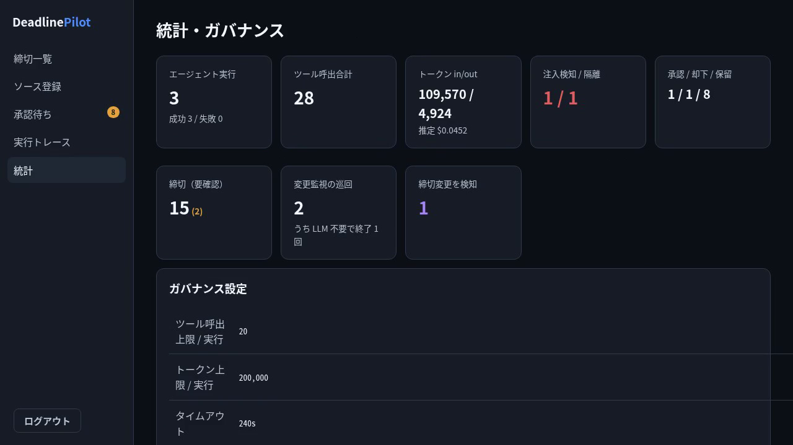
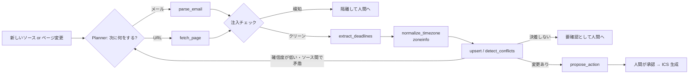

# DeadlinePilot

**一度メモした締切が、後から延長・変更されても気づける。**
告知メールや公式ページを AI エージェントが読み、締切を JST に揃えて管理し、
登録したページを見張り続けて「11/07 20:59 → 11/28 20:59 に延長」を人間に知らせる、
学生エンジニア向けの締切管理エージェントです。



▶ デモ動画（約3分）: https://youtu.be/zOrkEXp_Qn0

---

## 30秒で分かる DeadlinePilot

| よくある管理方法の困りごと | DeadlinePilot がやること |
|---|---|
| 締切は**後から延長・変更**されるのに、メモした締切は誰も見直さない | 登録したページを Cloud Scheduler が6時間ごとに再取得。ページの指紋が変わった時だけエージェントが起動し、旧→新の締切を報告 |
| AoE / UTC / PT / JST が混ざり、換算ミスで提出に遅れる | タイムゾーン計算は LLM にさせず、`zoneinfo` で決定的に JST へ変換 |
| 告知メール・公式ページ・Discord に情報が散らばる | URL やメール本文を貼るだけで、締切・必要アクション・優先度を抽出 |
| 外部のメールやページをそのまま LLM に読ませるのは危ない | 区切りタグ隔離＋ヒューリスティック＋Gemini 分類器で注入を検知し、本文をエージェントに渡さず隔離 |
| AI が勝手にカレンダーを書き換えるのは怖い | 外部への書き込みはすべて「提案」。人間が承認したものだけ実行 |

カレンダーアプリやタスク管理ツールは「入力した締切」を管理します。
DeadlinePilot は**締切の出どころ（公式ページ）を見張り続ける**ところが違います。

## スクリーンショット

| ダッシュボード（今やるべき3件＋JST 統一の締切一覧） | ソース登録と変更監視 |
|---|---|
|  |  |
| **ライブ実行：注入入りメールを検知して隔離** | **ページの変更を検知してエージェントが起動** |
|  |  |
| **旧→新の締切を照合して提案を作成** | **人間の承認ゲート** |
|  |  |
| **統計とガバナンス設定（トークン・コスト・上限）** | **アーキテクチャ** |
|  |  |

## エージェントは何を自分で判断するか

Google ADK の Planner（Gemini 2.5 Flash）は、目標「締切リストを最新かつ正確に保つ」に対して、
使うツールと順番を自分で決めます。固定のパイプラインではありません。



- **再評価ループ**: 確信度が低い、またはソース間で矛盾した時は、別ソースを取りに行って再検証します。
  それでも決着しなければ「要確認」として人間に返します。
- **変化がなければ LLM を呼ばない**: 指紋（正規化本文のハッシュ）が同じならエージェントは起動しないので、
  常時監視してもトークン消費はゼロです。

## 自律性をどう制御しているか

| 仕組み | 内容 |
|---|---|
| ツール allowlist | コード上の7種のみ（`TOOL_ALLOWLIST`）。それ以外は呼べない |
| ドメイン allowlist | `fetch_page` は許可ドメイン以外を拒否 |
| 実行上限 | 1実行あたりツール20回・トークン20万・240秒を Runner が強制 |
| 注入防御 | ①`<<UNTRUSTED_EXTERNAL_DATA>>` タグ隔離 ②ヒューリスティック ③Gemini Flash-Lite 分類器。検知時は fail-closed で隔離 |
| 人間の承認ゲート | 外部への書き込みは提案キューに入り、承認後のみ実行 |
| 可観測性 | 各ステップの判断理由・ツール入出力・所要時間・トークン・推定コストを Firestore と Cloud Logging に記録し、UI でライブ表示 |
| シークレット | Secret Manager（`SESSION_SECRET`, `JUDGE_PASSWORD`, `CRON_TOKEN`）。Scheduler からの起動は共有トークンで認証 |
| ログの扱い | メール本文や生テキストはログに出さず、要約のみ |

## アーキテクチャ


| 層 | 技術 |
|---|---|
| フロント | Vite + React + TypeScript → nginx（Cloud Run `deadlinepilot-web`） |
| バックエンド | FastAPI + Google ADK（Cloud Run `deadlinepilot-api`） |
| LLM | Vertex AI Gemini 2.5 Flash（注入分類器は Flash-Lite） |
| データ | Firestore（users / sources / deadlines / proposals / runs） |
| 定期実行 | Cloud Scheduler（6時間ごとに監視エンドポイントを呼ぶ） |
| その他 | Secret Manager, Cloud Logging, Cloud Trace |

## 費用

- Cloud Run は min-instances=0（アイドル時は課金なし）、max で暴走を防止
- 分類器は軽量な Flash-Lite、抽出とプランナーだけ Flash
- 外部テキストは切り詰め（16k / 24k 文字）てトークンを節約
- 実行ごとのトークンと推定コストを UI に表示
- 個人利用なら月数円〜数十円程度の想定

## ローカルで動かす

```bash
# backend
cd backend
python -m venv .venv && . .venv/bin/activate
pip install -r requirements.txt
USE_FIRESTORE=false SEED_DEMO=true JUDGE_PASSWORD='好きなパスワード' \
  uvicorn app.main:app --port 8080

# frontend（別シェル）
cd frontend && npm install
BACKEND_URL=http://localhost:8080 npm run dev   # http://localhost:5173
```

ユーザー名 `judge` と、上で設定した `JUDGE_PASSWORD` でログインできます。
`USE_FIRESTORE=false` は開発用のインメモリストアです。
Gemini 呼び出しには GCP 認証（`gcloud auth application-default login` と Vertex AI を有効にしたプロジェクト）が必要です。

## Cloud Run にデプロイ

```bash
gcloud auth login
export PROJECT_ID=your-project REGION=asia-northeast1
export JUDGE_PASSWORD='デモ用パスワード'
./deploy/setup.sh     # API 有効化・Firestore・SA・Secret Manager・Artifact Registry
./deploy/deploy.sh    # build と Cloud Run 2サービスのデプロイ
cd backend && USE_FIRESTORE=true python -m seed.seed   # サンプルデータ投入
```

## 制約と今後

- いまは単一ユーザー想定。複数ユーザーの権限分離は最小限です
- `fetch_page` の対象は許可ドメインのみ（Kaggle, AtCoder, Zenn, connpass, Devpost など）
- JavaScript で描画されるページは本文を取れない場合があります
- 今後: Gmail 連携による告知メールの自動取り込み、Google カレンダーへの直接書き込み（承認後）、
  Discord 告知の監視、締切の何日前に何をすべきかの逆算プラン

## このリポジトリについて

第5回 Agentic AI Hackathon with Google Cloud（Zenn）への提出作品です（2026年10月、1次審査で終了）。
提出後の振り返りは [docs/retrospective.md](docs/retrospective.md) にまとめています。

**今回開発したもの（すべて新規）**: `backend/`（FastAPI・ADK エージェント・ツール群・注入検知・タイムゾーン正規化・ICS 生成・トレース・シード）、
`frontend/`（UI 一式）、`deploy/`（プロビジョニングとデプロイのスクリプト）、`docs/`（構成図・デモ台本・振り返り）。

**利用したライブラリ・サービス**: google-adk, google-genai, google-cloud-firestore, fastapi, uvicorn, react, vite, nginx, trafilatura, itsdangerous, pydantic。
Vertex AI Gemini 2.5 Flash / Flash-Lite、Cloud Run、Cloud Scheduler、Firestore、Secret Manager、Cloud Logging。

## ライセンス

MIT License（[LICENSE](LICENSE)）。主な依存 OSS: FastAPI (MIT), Google ADK (Apache-2.0),
google-genai (Apache-2.0), trafilatura (Apache-2.0), httpx (BSD-3),
python-dateutil (Apache-2.0/BSD), React (MIT), Vite (MIT), React Router (MIT)。
