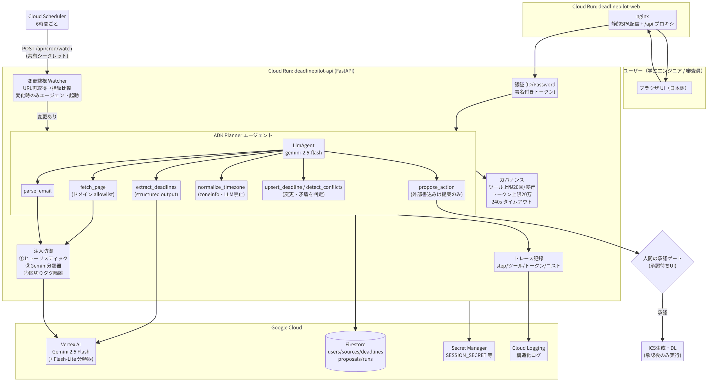

# DeadlinePilot

学生エンジニア向け コンペ／ハッカソン締切管理エージェント。
「作れる」ではなく「使える」— 自律的に動きつつ、可観測性・セキュリティ・
プロンプトインジェクション対策・ガバナンスを備えたエージェントです。

第5回 Agentic AI Hackathon with Google Cloud 提出作品。

## 対象ユーザーと課題

Kaggle・AtCoder・ハッカソン・奨学金・インターンなど、学生は数十の締切を
告知メール・公式ページ・Discord から手作業で管理しています。
AoE / UTC / PT / JST のタイムゾーン取り違えや登録漏れで機会を失うことが
よくあります。さらに締切は**後から延長・変更される**のに、一度メモした
締切を見直す人はほとんどいません。

## ソリューションと特徴

- **締切の変更を自律監視**: Cloud Scheduler が6時間ごとに登録 URL を
  再取得し、ページ指紋（本文ハッシュ）が変わったときだけエージェントを起動。
  エージェントは新旧の締切を照合し「旧 → 新」を人間に報告・ICS 更新を提案。
  変化がなければ LLM を呼ばない（トークン消費 0）ので常時監視でも低コスト。
  審査用に、締切を延長できる架空の主催者ページ（`/demo/notice/...`）を内蔵。
- **ライブ実行ビュー**: 実行中の各ステップ（判断理由・ツール・結果・所要時間）
  を UI にリアルタイム表示。生のモデル入出力も監査用に保存。
- **自律エージェント**: Google ADK の Planner（Gemini 2.5 Flash / Vertex AI）
  が目標「締切リストを最新・正確に保つ」に基づきツールの使用順を判断。
- **決定的な正規化**: タイムゾーン計算は LLM にさせず zoneinfo で変換
  （AoE=UTC-12, PT, ET, CET, KST… → JST/UTC）。
- **注入対策（3層）**: ①外部テキストを `<<UNTRUSTED_EXTERNAL_DATA>>` タグで
  隔離 ②ヒューリスティックパターン検査 ③Gemini 分類器。
  検知ソースは隔離（quarantine）され UI に警告表示。
- **ガバナンス**: ツール allowlist（7種）・ドメイン allowlist・
  ツール呼出上限20回/実行・トークン上限20万/実行・240秒タイムアウトを
  Runner が強制。Scheduler からの起動は共有シークレットで認証。
- **人間の承認ゲート**: 外部書き込み（カレンダー登録等）はすべて
  「提案」としてキューに入り、承認後のみ実行（ICS ダウンロード）。
- **可観測性**: 各ステップ（思考要約・ツール入出力・所要時間・トークン・
  推定コスト）を Firestore + Cloud Logging に記録、UI でタイムライン表示。
- **再評価ループ**: confidence 低下・ソース間矛盾は別ソース取得で再検証、
  決着しなければ「要確認」として人間に返す。

## アーキテクチャ



| 層 | 技術 |
|---|---|
| フロント | Vite + React + TS → nginx（Cloud Run `deadlinepilot-web`） |
| バックエンド | FastAPI + Google ADK（Cloud Run `deadlinepilot-api`） |
| LLM | Vertex AI Gemini 2.5 Flash（分類器は Flash-Lite） |
| データ | Firestore（users/sources/deadlines/proposals/runs） |
| その他 | Secret Manager, Cloud Logging, Cloud Trace |

## セットアップ（ローカル）

```bash
# backend
cd backend
python -m venv .venv && . .venv/bin/activate
pip install -r requirements.txt
USE_FIRESTORE=false SEED_DEMO=true JUDGE_PASSWORD='任意' \
  uvicorn app.main:app --port 8080

# frontend (別シェル)
cd frontend && npm install
BACKEND_URL=http://localhost:8080 npm run dev   # http://localhost:5173
```

`USE_FIRESTORE=false` は開発用インメモリストア。Gemini 呼び出しには
GCP 認証（`gcloud auth application-default login` + Vertex AI 有効化
プロジェクト）が必要です。

## デプロイ（Cloud Run）

```bash
gcloud auth login
export PROJECT_ID=your-project REGION=asia-northeast1
export JUDGE_PASSWORD='審査用パスワード'
./deploy/setup.sh     # API有効化・Firestore・SA・Secret Manager・AR
./deploy/deploy.sh    # build + Cloud Run 2サービス
python -m seed.seed   # backend/ から。JUDGE_PASSWORD と USE_FIRESTORE=true
```

min-instances=0, max=5/3 でコスト最小化。

## デプロイ済み環境（審査用）

- **アプリ**: https://deadlinepilot-web-6hgkaj4aiq-an.a.run.app
- API: https://deadlinepilot-api-6hgkaj4aiq-an.a.run.app （`/api/health` で生存確認可）
- GCP プロジェクト: `deadlinepilot-tm`（asia-northeast1、Vertex は us-central1）

## 審査用テストアカウント

- ID: `judge` / PW: `ChangeMe-Demo-2026!`（デプロイ時の `JUDGE_PASSWORD`）
- 投入済みサンプル: 締切10件（AoE/PT/UTC/JST 混在・矛盾1件・要確認1件）、
  未処理ソース3件（クリーン2件＋**注入入り悪意メール1件**）、承認待ち1件

デモの流れは `docs/demo_script.md`、提出文は `docs/submission.md`。

## 開発範囲の明示

**今回開発したもの（全て新規）**: `backend/`（FastAPI・ADK エージェント・
ツール群・注入検知・tz 正規化・ICS 生成・トレース・シード）、
`frontend/`（UI 一式）、`deploy/`（プロビジョニング/デプロイスクリプト）、
`docs/`（アーキテクチャ図・デモ台本・提出文）。

**既存ライブラリ・サービス**: google-adk, google-genai, google-cloud-firestore,
fastapi, uvicorn, react, vite, nginx, trafilatura, itsdangerous, pydantic。
Vertex AI Gemini 2.5 Flash / Flash-Lite、Cloud Run、Firestore、
Secret Manager、Cloud Logging。

## 費用対効果の工夫

- Cloud Run min-instances=0（アイドル時ゼロ課金）、max 上限で暴走防止
- 分類器は軽量 Flash-Lite、抽出/プランナーのみ Flash
- 外部テキストは切り詰め（16k/24k chars）してトークン削減
- トークン・推定コストを実行ごとに可視化し、コスト意識を UI 化
- ガバナンス上限が LLM ループの暴走＝課金暴走も防止

## セキュリティ設計

- ツールはコード上の allowlist（`TOOL_ALLOWLIST`）のみ。他は呼べない。
- `fetch_page` はドメイン allowlist 外を拒否。
- 外部テキストは常に untrusted タグ内。システム指示と分離。
- 注入検知はヒューリスティック→Gemini 分類器の二層、検知時 fail-closed で隔離。
- シークレットは Secret Manager（SESSION_SECRET, JUDGE_PASSWORD）。
- ログにメール本文・生テキストを出さない（要約のみ）。
- 人間承認なしの外部書き込みは不可（propose_action は永続化のみ）。

## ライセンス

MIT License（`LICENSE`）。主な依存 OSS: FastAPI (MIT), Google ADK (Apache-2.0),
google-genai (Apache-2.0), trafilatura (Apache-2.0), httpx (BSD-3),
python-dateutil (Apache-2.0/BSD), React (MIT), Vite (MIT), React Router (MIT)。
